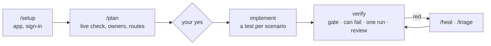

# Playwright AI Workflow Kit

A Playwright + TypeScript test project you build with an AI agent — **Claude Code, Cursor or GitHub Copilot**.
The agent plans tests from your cases, writes them and proves they work; the kit's rules, scripts and checks keep
its work reviewable. It ships with no application tests — only the machinery around them.

## What you get

- **A plan before any test.** The agent checks the feature on the live app and shows what it will write — each
  case's owner (API, UI or E2E), its checks, priority and reason — then waits for your yes.
- **One scenario, one test.** No result is proven twice; the API covers what no screen shows.
- **Checks that can fail.** `npm run verify` spoils each new expected value; the test must go red at that line.
- **Failures that explain themselves.** Each red test opens with a verdict — possible bug, product changed, stand
  or data, setting missing, test needs fixing — and what to check by hand.
- **Guards the agent cannot skip.** A quality gate, and a stop check that sends the agent back when its work
  breaks the gate or a red run is left unhealed.
- **Sign-in, test data and cleanup from one project map.** Secrets stay in `.env`, never in the chat or reports.
- **One install, kept up to date** — into any folder of your project, with your AI and your CI.

## How it works



| Step | What appears | Who decides |
|---|---|---|
| `/setup` | the app's row and sign-in block in `specs/project-map.md`, empty login names in `.env`, a green sign-in smoke | you type the secrets into `.env` |
| `/plan` | `specs/<app>/<area>/<feature>/<feature>.md` — each case with its owner, route, data, steps and status | you confirm or adjust the plan |
| implement | `tests/<layer>/<app>/…spec.ts`, Page Objects, clients, fixtures — each test started by `npm run spec:draft` | the plan |
| verify | one block of results; each new check seen red once on purpose; an independent review | the gate and the run |

A case in a plan, and the test it becomes (from the [demo](https://github.com/Avngrss/playwright-ai-workflow-kit/tree/demo/todomvc)):

```markdown
### 2. A completed todo leaves the items-left counter
- Level: UI — the mark and the counter on this screen · Tag: @regression
- Route: no-request · screen list=value
- Preconditions: "buy milk" and "walk the dog" in the list, neither done
- Steps:
  1. Complete "buy milk"
     - expect: "buy milk" is shown completed and the counter says "1 item left"
```

```ts
await test.step('Setup: add "buy milk" and "walk the dog"', () => todoListPage.addTodos(["buy milk", "walk the dog"]));
await test.step('Complete "buy milk" and verify the counter', async () => {
  await todoListPage.complete("buy milk");
  expect(await todoListPage.read(), "The todo list").toEqual(
    shownTodoList({ todos: ["buy milk", "walk the dog"], completed: ["buy milk"], left: 1 }),
  );
});
```

`Level` names the one owner: TodoMVC sends no request, so the result lives only on the screen and there is no API
test of it. `Route` says how the test proves it — here the screen alone; with a request, the answer the action got
and the screen built from the case's data ([Layer Routing Algorithm](docs/Layer%20Routing%20Algorithm.md)).

## Quick start

In your project's folder (Node 20+, git):

```bash
npx github:Avngrss/playwright-ai-workflow-kit
```

It asks where (`qa` by default), which AI (one or several) and which CI (GitHub, GitLab or none), copies the kit
with only your AI's files, writes the CI, runs `npm ci` and creates `.env`. It never overwrites a file and commits
nothing. Without questions: `npx github:Avngrss/playwright-ai-workflow-kit qa --agent claude --ci github --yes`.

Then open **the kit's folder** in your AI, turn on the `playwright` MCP server and type:

1. `/setup` — add your app and how its tests sign in;
2. `/plan <a TMS link, a ticket or your words>` — answer **Yes, write them**: the agent writes the tests,
   verifies them and sums up.

Later, in the same folder:

- `npx github:Avngrss/playwright-ai-workflow-kit --update` — the kit's newest version (`--dry-run` shows the plan;
  a file you changed stays, the new version goes beside it as `<file>.kit-new`);
- `npm run agents:use -- copilot` — change or add an AI (`claude`, `cursor`, `copilot`, or several: `claude,copilot`).

A repository of its own instead: **Use this template** on GitHub. Step by step: [docs/getting-started.md](docs/getting-started.md).

## See it in action

The [`demo/todomvc`](https://github.com/Avngrss/playwright-ai-workflow-kit/tree/demo/todomvc) branch is the kit
after one pass on [TodoMVC](https://demo.playwright.dev/todomvc) — its README lists every file the agent wrote.
Run it — no account needed:

```bash
git clone -b demo/todomvc https://github.com/Avngrss/playwright-ai-workflow-kit.git todomvc-demo
cd todomvc-demo && npm install && npm run env:prepare
npm test               # 6 passed
npm run allure:open
```


A failure made on purpose — the test expects "2 items left":


## Commands

| Command | When |
|---|---|
| `/setup` | add an app, set up how its tests sign in, add an account or role |
| `/plan` | plan a feature or an E2E journey; on an existing plan — a later pass, or a refresh after a change |
| `/implement` | write a plan's ready cases |
| `/verify` | check what was written: one `npm run verify`, the report, the reviews, a summary |
| `/heal` | one or two red tests |
| `/triage` | three or more red tests, or a CI run |
| `/coverage` | a TMS folder, case by case |
| `/review` | an independent review of new tests — Claude Code and Copilot run it as their `reviewer` agent |

A run's summary ends with the command it needs next. In Copilot the commands are skills called by name.

## Your AI

| | Claude Code | Cursor | GitHub Copilot |
|---|---|---|---|
| Its files | `.claude/`, `.mcp.json` | `.cursor/` (the skills from `.claude/` when both) | `.github/`: instructions, skills, agent, hook; `.mcp.json` |
| Playwright MCP | approve it once | Cursor Settings → MCP | Copilot CLI reads it; VS Code with its workspace MCP setting on |
| Independent review | `reviewer` subagent | `/review` in a new chat | `reviewer` agent |
| Stop check | Stop hook | stop hook | `agentStop` hook |

All are copies of `agents/`, written by `npm run agents:sync` — edit `agents/`, never a copy.

## Scripts you use most

| Script | What it does |
|---|---|
| `npm run verify -- <app> <spec>` | the gate, each new check proven able to fail, one run, one block of results |
| `npm test` · `npm run test:app -- <app>` | every test · one app's |
| `npm run qa:gate` | the conventions, then `tsc` — before every commit |
| `npm run allure:open` | the report |
| `npm run env:prepare` | `.env` names and addresses — you type the secrets |
| `npm run agents:use -- <ai>` | which AI this folder works with |

Every script: `npm run help`.

## CI

The installer writes GitHub's or GitLab's: the gate, a secret scan, the test list, then smoke, regression, visual,
cross-browser and responsive jobs with the report. Give CI the map's `.env` names as variables (GitHub: `env:prepare`
adds each to the workflow and says what to create). Screenshot baselines for Linux: GitHub — Actions → **Run workflow**; GitLab — the manual
`test:visual-baselines` job.

**Before the first green run:** create each name in the repository — GitHub: Settings → Secrets and variables →
Actions, addresses (`UI_BASE_URL` …) as **Variables**, logins and passwords as **Secrets**. Without them the gate
passes, but each app's smoke fails with *setting missing* and that app's other tests do not run.

## Documentation

| Read | When |
|---|---|
| [Getting started](docs/getting-started.md) | first install, up to the first plan |
| [Workflow](docs/workflow.md) | every day: which command after a run, what each one shows (§5 has the real shapes) |
| [Test strategy](docs/test-strategy.md) | to agree with the team on layers, structure, definition of done |
| [Failure reporting](docs/failure-reporting.md) | a red test: what each verdict means and what to do |
| [Sign-in](docs/auth-strategy.md) | accounts, roles, SSO, a refused sign-in |
| [Secrets and data](docs/security-data-handling.md) | what may end up in reports, traces and CI |
| [Layer Routing Algorithm](docs/Layer%20Routing%20Algorithm.md) | why a scenario has one owner and one test, in depth |

## Known limitations

- Codex is not set up yet.
- A rule is still text: a weaker model can skip what no script checks — the plan's confirm is where you catch it.
- An update merges no file by itself: compare each `<file>.kit-new` with yours.
- The agent works with the live app: it must be reachable, and an app behind a sign-in needs a test account.
- Allure's report packages carry `npm audit` findings and an older DOMPurify in the report page: share reports
  with restricted access.

## License

[MIT](LICENSE) © 2026 Yury Siadou
