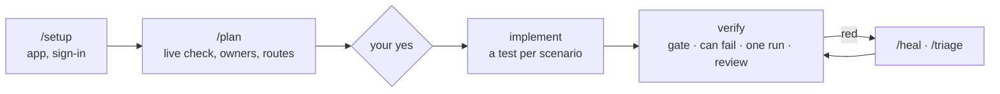

# Playwright AI Workflow Kit

A Playwright + TypeScript test project you build with an AI agent. The agent plans tests from your cases, writes
them and proves they work; the kit's rules, scripts and checks keep its work reviewable. It ships with no
application tests — only the machinery around them.

## What you get

- **A plan before any test.** The agent checks the feature on the live app and shows what it will write — each
  case's owner (API, UI or E2E), its checks, priority and reason — then waits for your yes.
- **One scenario, one test.** No result is proven twice; the API covers what no screen shows.
- **Checks that can fail.** `npm run verify` spoils each new expected value; the test must go red at that line.
- **Failures that explain themselves.** Each red test opens with a verdict — possible bug, product changed, stand
  or data, setting missing, test needs fixing — and what to check by hand.
- **Guards the agent cannot skip.** A quality gate, and a stop check that sends the agent back when its work
  breaks the gate or a red run is left unhealed.
- **Sign-in, test data and cleanup from one project map.** Secrets stay in `.env`, never in the chat or reports.

## Which AI

| | Claude Code | Cursor | GitHub Copilot (VS Code, Copilot CLI) |
|---|---|---|---|
| Its files | `.claude/`, `.mcp.json` | `.cursor/` | `.github/` (instructions, skills, agent, hook), `.mcp.json` |
| Turn on the Playwright MCP | approve it when asked | Cursor Settings → MCP | Copilot CLI reads `.mcp.json`; VS Code — its workspace MCP setting on |
| Commands | `/setup`, `/plan` … | `/setup`, `/plan` … | skills called by name |
| Independent review | `reviewer` subagent | `/review` in a new chat | `reviewer` agent |
| Stop check | Stop hook | stop hook | `agentStop` hook |

Codex is not set up yet.

- **The Playwright MCP** is how the agent sees the live app: it opens pages, reads the screen and the requests each
  action sends. Without it the agent cannot plan or fix a locator — turn it on once per AI.
- **Choosing the AI.** The installer asks; later `npm run agents:use -- cursor` (or `claude`, `copilot`, several:
  `claude,copilot`) adds the chosen AI's files and removes the others'. `npm run agents:use` alone says which are on.
- **One source for every AI.** Rules, skills and commands live in `agents/`; the AI folders above are copies written
  by `npm run agents:sync`. Edit `agents/`, never a copy — the gate fails a copy edited by hand.

## Install

Node 20+ and git. Two ways:

| Your case | Do |
|---|---|
| Tests next to your product's code (a `qa/` folder of its repository) | in that repository: `npx github:Avngrss/playwright-ai-workflow-kit` — it asks the folder, the AI and the CI, copies only your AI's files, writes the CI, runs `npm ci` and creates `.env`; never overwrites a file, commits nothing |
| A repository of its own for the tests | **Use this template** on GitHub, clone it, then `npm install`, `npm run env:prepare`, `npm run agents:use -- <ai>` |

Then:

1. Open **the kit's folder** in your AI (the `qa/` folder, not the repository's root) and turn on the Playwright MCP.
2. `/setup` — add your app and how its tests sign in; you type the test account into `.env` yourself.
3. `/plan <a TMS link, a ticket or your words>` — answer **Yes, write them**: the agent writes the tests, verifies
   them and sums up.

Each step, what the installer may say, the TMS through MCP: [Getting started](docs/getting-started.md). The kit's
newest version later: `npx github:Avngrss/playwright-ai-workflow-kit --update` in the same folder.

## Where everything is

| Path | What | Who edits it |
|---|---|---|
| `agents/` | rules, skills and commands every AI follows, MCP and hooks | you, then `npm run agents:sync` |
| `.claude/`, `.cursor/`, `.github/`, `.mcp.json` | your AI's copies of `agents/` (`.github/workflows/` is the CI) | nobody — generated |
| `specs/project-map.md` | apps, their `.env` names, sign-in, tags, locks — code and the gate read it | the agent (`/setup`) |
| `specs/<app>/<area>/<feature>/<feature>.md` | a feature's plan; an E2E journey's: `specs/e2e/<app>/<area>/` | the agent (`/plan`), you confirm |
| `tests/<api\|ui\|e2e>/<app>/…` | the tests; `tests/smoke/` holds the sign-in smoke | the agent (`/implement`) |
| `src/pages/<app>/`, `src/api/clients/<app>/`, `src/data/…/<app>/`, `src/fixtures/<app>/` | the app's Page Objects, API clients, test data, fixtures | the agent |
| `src/setup/`, `src/reporting/`, `src/fixtures/*.ts`, `scripts/` | the kit's own machinery: sign-in, report, gate, verify | only on your request |
| `.env` (`.env.example` lists the names) | addresses and test accounts — git-ignored | you, with `npm run env:prepare` |
| `state/` | saved sign-in sessions — git-ignored | the tests |
| `reports/`, `test-results/` | the last run: `run-summary.md`, `test-result.md`, the Allure report | the runs |
| `docs/` | this documentation | — |
| `bin/`, `ci/gitlab/` | the installer and its tests; GitLab's CI template | — |

## How it works

| Step | What appears | Who decides |
|---|---|---|
| `/setup` | the app's row and sign-in block in `specs/project-map.md`, empty login names in `.env`, a green sign-in smoke | you type the secrets into `.env` |
| `/plan` | the feature's plan — each case with its owner, route, data, steps and status | you confirm or adjust it |
| implement | the tests, Page Objects, clients, fixtures — each test started by `npm run spec:draft` | the plan |
| verify | one block of results; each new check seen red once on purpose; an independent review | the gate and the run |

Why each scenario has one owner and one test: [Layer Routing Algorithm](docs/Layer%20Routing%20Algorithm.md).

## Demo

The [`demo/todomvc`](https://github.com/Avngrss/playwright-ai-workflow-kit/tree/demo/todomvc) branch is this kit
after one pass on [TodoMVC](https://demo.playwright.dev/todomvc): the plan, the tests, the report — and how to run
it in four commands, no account needed.

## Commands

| Command | When |
|---|---|
| `/setup` | add an app, set up how its tests sign in, add an account or role |
| `/plan` | plan a feature or an E2E journey; on an existing plan — a later pass, or a refresh after a change |
| `/implement` | write a plan's ready cases |
| `/verify` | check what was written: one `npm run verify`, the report, the reviews, a summary |
| `/heal` | one or two red tests |
| `/triage` | three or more red tests, or a CI run |
| `/coverage` | a TMS folder, case by case |
| `/review` | an independent review of new tests, in a new chat |

A run's summary ends with the command it needs next. Which command when: [Workflow](docs/workflow.md).

## Scripts you use most

| Script | What it does |
|---|---|
| `npm run verify -- <app> <spec>` | the gate, each new check proven able to fail, one run, one block of results |
| `npm test` · `npm run test:app -- <app>` | every test · one app's |
| `npm run qa:gate` | the conventions, then `tsc` — before every commit |
| `npm run allure:open` | the report |
| `npm run env:prepare` | `.env` names and addresses — you type the secrets |
| `npm run agents:use -- <ai>` | which AI this folder works with |

Every script: `npm run help`.

## CI

The installer writes GitHub's or GitLab's workflow: the gate, a secret scan, then smoke, regression, visual,
cross-browser and responsive jobs with the report; on GitHub the tests run in the Playwright image, so no browser
is downloaded. Before the first green run, CI needs the map's `.env` names as variables and secrets:
[Getting started §6](docs/getting-started.md#6-ci).

## Documentation

| Read | When |
|---|---|
| [Getting started](docs/getting-started.md) | first install, up to the first plan |
| [Workflow](docs/workflow.md) | every day: which command after a run, what each one shows (§5 has the real shapes) |
| [Test strategy](docs/test-strategy.md) | to agree with the team on layers, structure, definition of done |
| [Failure reporting](docs/failure-reporting.md) | a red test: what each verdict means and what to do |
| [Sign-in](docs/auth-strategy.md) | accounts, roles, SSO, a refused sign-in |
| [Secrets and data](docs/security-data-handling.md) | what may end up in reports, traces and CI |
| [Layer Routing Algorithm](docs/Layer%20Routing%20Algorithm.md) | why a scenario has one owner and one test, in depth |

## Known limitations

- A rule is still text: a weaker model can skip what no script checks — the plan's confirm is where you catch it.
- An update merges no file by itself: compare each `<file>.kit-new` with yours.
- The agent works with the live app: it must be reachable, and an app behind a sign-in needs a test account.
- Allure's report packages carry `npm audit` findings and an older DOMPurify in the report page: share reports
  with restricted access.

## License

[MIT](LICENSE) © 2026 Yury Siadou
