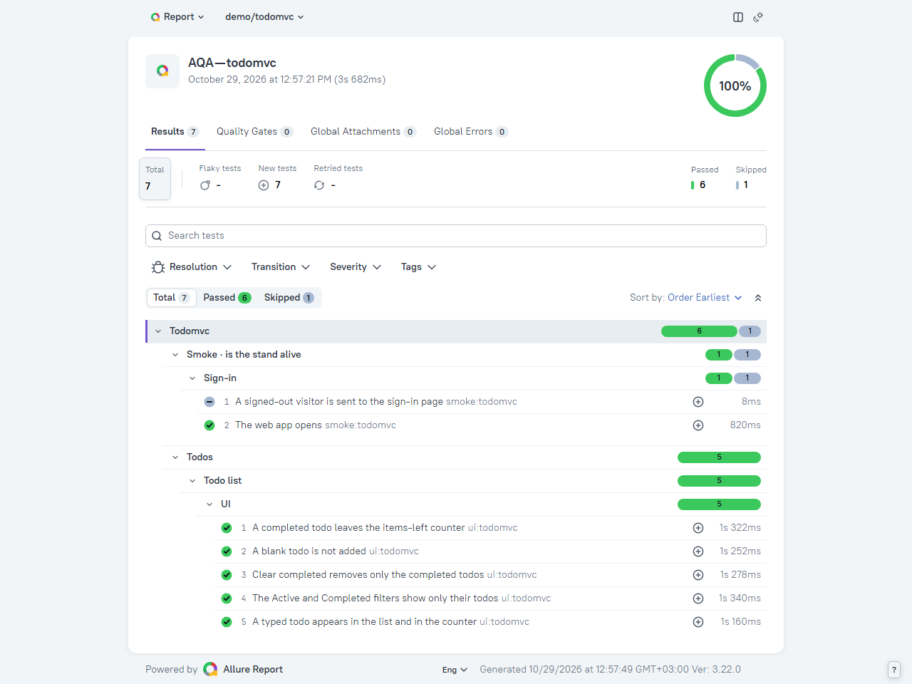
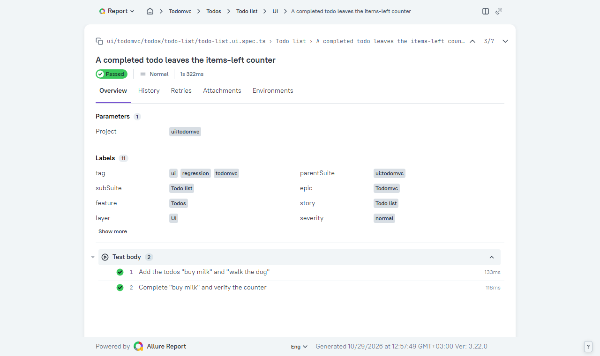
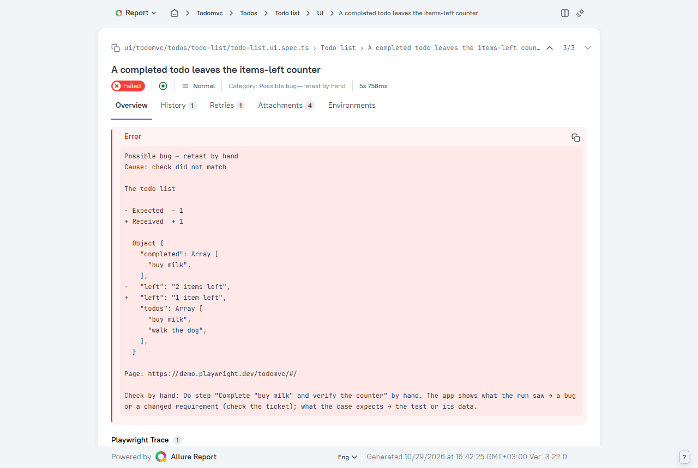

# TodoMVC demo — Playwright AI Workflow Kit

[](https://github.com/Avngrss/playwright-ai-workflow-kit/actions/workflows/playwright.yml?query=branch%3Ademo%2Ftodomvc)

> **This branch is a demo, not the kit.** The kit, its install and its documentation live on
> [`main`](https://github.com/Avngrss/playwright-ai-workflow-kit). Here is what one pass of the kit's agent left behind
> on a real app — and nothing else.

The app is [TodoMVC](https://demo.playwright.dev/todomvc): public, no account, no API — the list lives in the
browser. The agent ran `/setup`, `/plan`, `/implement` and `/verify` on it once; this branch is `main` plus the files
that pass wrote.

## Run it

```bash
git clone -b demo/todomvc https://github.com/Avngrss/playwright-ai-workflow-kit.git todomvc-demo
cd todomvc-demo && npm install && npm run env:prepare   # .env gets the TodoMVC address, nothing to type
npm test                                                # 6 passed: the "web app opens" smoke + 5 UI tests
npm run allure:open
```

## What the agent wrote

Everything this demo adds to `main` — eight files:

| File | What it is |
|---|---|
| [`specs/project-map.md`](specs/project-map.md) | the app's row (`todomvc`, `UI_BASE_URL`) and its sign-in block: `ui: none`, `api: none` — a public app |
| [`.env.example`](.env.example) | `UI_BASE_URL=https://demo.playwright.dev/todomvc` |
| [`specs/todomvc/todos/todo-list/todo-list.md`](specs/todomvc/todos/todo-list/todo-list.md) | the plan: 5 cases to write, 2 *Not now*, owners, routes, browsers / phone / screenshots decided |
| [`tests/ui/todomvc/todos/todo-list/todo-list.ui.spec.ts`](tests/ui/todomvc/todos/todo-list/todo-list.ui.spec.ts) | the 5 tests, one per case, steps worded as the case |
| [`src/pages/todomvc/todo-list.page.ts`](src/pages/todomvc/todo-list.page.ts) | the Page Object: actions and one `read()` of the list — no checks inside |
| [`src/assertions/todomvc/todo-list.ts`](src/assertions/todomvc/todo-list.ts) | `shownTodoList()` — the expected list built from the case's data |
| [`src/fixtures/todomvc/`](src/fixtures/todomvc/) | the app's fixtures: the page, and `listWithOneDone` — the list two cases start from |
| [`docs/images/`](docs/images/) | the report screenshots below |

## From the plan to the test

The plan decided the owner from the live app: TodoMVC sends no request, so every result is on the screen and
every case is a UI test with route `no-request` — no API test, nothing proven twice:

```markdown
## Owners
- found: UI 5 · API 0 · E2E 0 — none: the app sends no request (…the list lives in localStorage)

### 2. A completed todo leaves the items-left counter
- Level: UI — the mark and the counter on this screen · Tag: @regression
- Route: no-request · screen list=value
- Preconditions: "buy milk" and "walk the dog" in the list, neither done
- Steps:
  1. Complete "buy milk"
     - expect: "buy milk" is shown completed and the counter says "1 item left"
```

The test it became — the preconditions as a `Setup:` step, the case's step as one step with its check:

```ts
test("A completed todo leaves the items-left counter", { tag: ["@ui", "@regression"], annotation: severity.major },
  async ({ todoListPage }) => {
    await test.step('Setup: add "buy milk" and "walk the dog"', () => todoListPage.addTodos(["buy milk", "walk the dog"]));
    await test.step('Complete "buy milk" and verify the counter', async () => {
      await todoListPage.complete("buy milk");
      expect(await todoListPage.read(), "The todo list").toEqual(
        shownTodoList({ todos: ["buy milk", "walk the dog"], completed: ["buy milk"], left: 1 }),
      );
    });
  });
```

Before it was called done, `npm run verify` spoiled each expected value once (the test had to go red at that line),
then ran the five tests in one pass without a retry.

## The report





A failure made on purpose — the test expects "2 items left":



## What this demo does not show

TodoMVC has no sign-in, no API and no TMS, so none of these appear here: API tests and clients, test accounts and
roles, E2E journeys, case links, `@visual` / `@cross-browser` / `@responsive` tests (the plan's
`## Browsers, phone, screenshots` says why each is `none`). How they work: the docs on
[`main`](https://github.com/Avngrss/playwright-ai-workflow-kit#documentation).

The `docs/`, `agents/` and `scripts/` folders here are the kit's own, unchanged — the agent reads them; to read
them yourself, read them on `main`.

## CI on this branch

The workflow is `main`'s. One difference: the TodoMVC address is public, so `UI_BASE_URL` falls back to it when
the repository has no `UI_BASE_URL` variable — in your own project, set the variable (Settings → Secrets and
variables → Actions → Variables), or smoke fails with *setting missing* and the app's other tests do not run.

## Keeping the demo up to date

```bash
git config merge.ours.driver true   # once per clone: this README stays the demo's (.gitattributes)
git switch demo/todomvc && git merge origin/main
npm ci && npm run qa:gate && npm test
```
